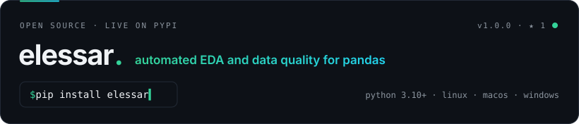
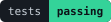
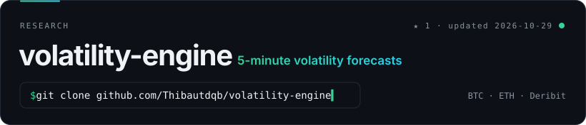

<!-- Thibaut de Quatrebarbes · GitHub profile. Images in assets/generated are drawn by
     scripts/cards.py from live GitHub and PyPI data and refreshed daily by .github/workflows/cards.yml. -->

<picture><source media="(prefers-color-scheme: light)" srcset="assets/generated/divider-light.svg" /></picture>

 

<picture><source media="(prefers-color-scheme: light)" srcset="assets/generated/divider-light.svg" /></picture>

<a href="https://github.com/Thibautdqb/elessar"><picture><source media="(prefers-color-scheme: light)" srcset="assets/generated/elessar-light.svg" /></picture></a>

profiles a pandas DataFrame, or any data file, in one call.
It types every column with an explicit decision tree, tests every association for significance, analyses the
target, the outliers and the time series, and writes an HTML report with the code to fix what it finds.

<a href="https://pypi.org/project/elessar/"><picture><source media="(prefers-color-scheme: light)" srcset="assets/generated/badge-pypi-light.svg" /></picture></a>
<a href="https://pypi.org/project/elessar/"><picture><source media="(prefers-color-scheme: light)" srcset="assets/generated/badge-python-light.svg" /></picture></a>
<a href="https://github.com/Thibautdqb/elessar/actions/workflows/ci.yml"><picture><source media="(prefers-color-scheme: light)" srcset="assets/generated/badge-tests-light.svg" /></picture></a>

<picture><source media="(prefers-color-scheme: light)" srcset="assets/generated/divider-light.svg" /></picture>

<a href="https://github.com/Thibautdqb/volatility-engine"><picture><source media="(prefers-color-scheme: light)" srcset="assets/generated/volatility-engine-light.svg" /></picture></a>

forecasts five-minute volatility, the probability
of a violent move and the market regime for BTC and ETH perpetuals on Deribit, evaluated walk-forward on six months
of verified trade data.

<picture><source media="(prefers-color-scheme: light)" srcset="assets/generated/divider-light.svg" /></picture>

